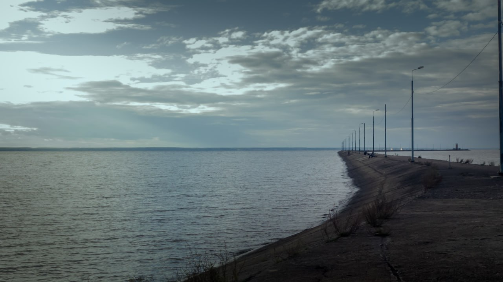

# Here we are 🥥

It seems that I have a GitHub too, so, for someone who see this and don't know about me:

## I'm Toiterr
Real name is Maxim, some kind of geek 🤓 (🫩)

For several years I practise in photography, video editing(and creating) and coding

If you care:
---

Photography

I'm used to take pictures of nature, but them is quite same, so I quickly started practising in color grading

Videos

Most of videos are uploaded on youtube

* [Toiter](https://www.youtube.com/@toiterr) - humorous and not very serious
* [Atarash](https://www.youtube.com/@atarashkin) - smaller but more complex and compound

> At the start, there were only Toiter, and it still not all videos moved

## Code
At the start(~2020) I was writing JS/Python bots(not all by myself, mostly not all...).

Now I am student of MIET and practising in C++/C#, let's see what it'll develop into 🤷

