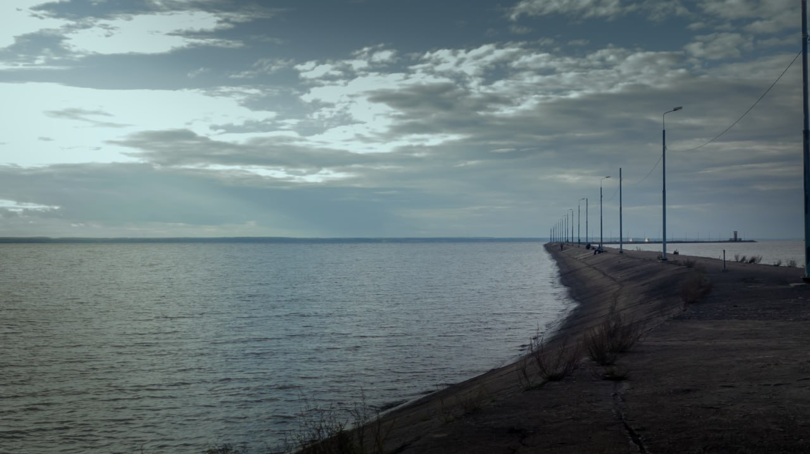

# Here we are 🥥

It seems that I have a GitHub too, so for someone who sees this and don't know me:

## I'm Toiterr
Real name is Maxim, some kind of geek 🤓 (🫩)

For several years I've been practicing photography, video editing(and creating) and coding

If you care:
---

Photography

I'm used to take pictures of nature, but them all look quite same, so I quickly started practicing color grading

Videos

Most of videos are uploaded on Youtube:

* [Toiter](https://www.youtube.com/@toiterr) - humorous and not very serious
* [Atarash](https://www.youtube.com/@atarashkin) - smaller but more complex and compound

## Code
At the start(~2020), I was writing JS/Python bots(not all by myself, mostly not by myself...).  
Since that time I've coded some raw minigames(on C#/Lua), which are now lost.

Today I'm student of MIET and I'm practicing in C++/C#, let's see what it develops into 🤷

